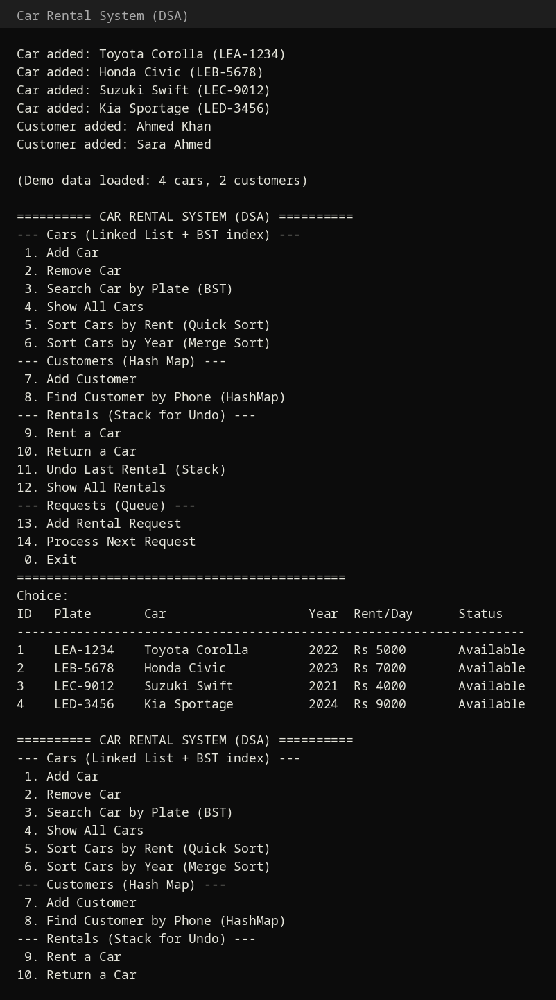

# 🚗 Car Rental System — DSA Edition

My **Data Structures & Algorithms (DSA) semester project** — a high-level re-implementation of the Car Rental System, powered by **custom data structures written from scratch** (no STL containers for the core logic).

## 🧠 Data Structures Used

| Structure | Purpose | Complexity |
|---|---|---|
| **Singly Linked List** | Car inventory | Insert O(n), Search O(n) |
| **Binary Search Tree** | License-plate → car index | Search O(log n) avg |
| **Hash Map** (chaining, djb2) | Phone → customer lookup | O(1) avg |
| **Stack** | Undo last rental | O(1) |
| **Queue** (circular buffer) | Pending rental requests (FIFO) | O(1) amortized |

## ⚡ Algorithms Implemented

- **Quick Sort** — sort cars by rent per day (O(n log n) average)
- **Merge Sort** — sort cars by manufacturing year (O(n log n))

## ✨ Features

- Add / remove / search cars (BST-powered plate search)
- Add customers & O(1) lookup by phone (hash table)
- Rent a car with automatic cost calculation
- Return a car
- **Undo** the last rental (stack)
- **Queue** rental requests and process them first-come, first-served
- Sort inventory by price or year

## 📁 Project Structure

```
├── main.cpp              # Menu-driven console interface
├── Models.h              # Car, Customer, Rental, RentalRequest
├── DataStructures.h      # LinkedList, BST, Stack, Queue, HashMap (from scratch)
├── Algorithms.h          # Quick Sort, Merge Sort (from scratch)
└── RentalSystem.h        # Core system wiring everything together
```

## ▶️ How to Run

```bash
g++ -o car_rental_dsa main.cpp -std=c++17
./car_rental_dsa
```

## 📸 Screenshot



## 🛠️ Tech

- C++17 (console application)
- All data structures & sorting algorithms implemented manually

## 👩‍💻 Author

**Ayesha Shoukat** — Computer Science @ UET Narowal
